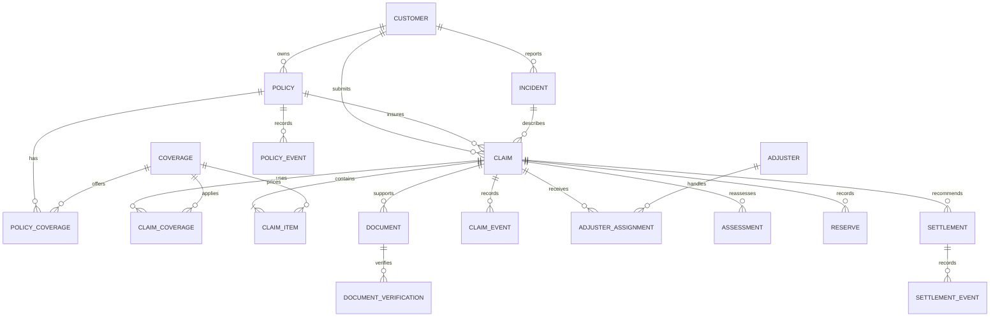

# YottaFlex Insurance Claims Processing System

A deterministic, local-first prototype for the YottaFlex.ai Round 2, 72-hour
code challenge. It implements policy and coverage setup, claim intake, evidence
verification, eligibility assessment, adjuster assignment, reserve and
settlement recommendations, fraud/exception indicators, and auditable lifecycle
history.

The supplied challenge screenshots are treated as the acceptance criteria. The
implementation uses synthetic data only; it does not fetch or redistribute
external data or store actual document contents.

## What is delivered

- Relational SQLite schema for all 11 requested core entities, with explicit
  bridge and event tables.
- FastAPI endpoints for customer registration, policy creation, claim
  submission, claim processing, payment attempts, and claim review.
- Fixed-seed generator (default seed `20261022`) for 2,000 policies and 1,000
  claims across five claim types.
- Item-derived claim totals, assessment, reserve, and settlement calculations
  using integer cents.
- Separate `ground_truth.json` and `ground_truth.csv`; labels are generated
  from source-record rules and are not columns in the input claim table.
- Integrity, business-rule, lifecycle, duplicate-detection, and export/checksum
  validation.
- Automated generator, API, and reproducibility tests.

## Technology choices

| Area | Choice | Reason |
|---|---|---|
| Language | Python 3.11+ | Readable domain rules and a compact local prototype |
| API | FastAPI + Pydantic | Typed request validation and an OpenAPI interface |
| Database | SQLite via `sqlite3` | Zero-service local setup, explicit SQL, real foreign keys |
| Tests | pytest + FastAPI TestClient | Focused rule, API, integrity, and determinism checks |
| Exports | CSV, JSON, SQL dump, SQLite | Portable evaluator inputs plus a runnable database |

SQLite is intentional for a reproducible 72-hour prototype. The SQL schema,
repository boundaries, stable IDs, and append-only event records make a later
move to PostgreSQL straightforward. This is not a production deployment recipe:
authentication, authorization, managed storage, observability, and real payment
integrations are out of scope.

## Architecture

```mermaid
flowchart LR
    M[Customer, Policy, Coverage] --> I[Claim and Incident Intake]
    I --> E[Items and Document Metadata]
    E --> V[Relationship, Coverage, and Evidence Validation]
    V --> D[Eligibility and Duplicate Rules]
    D --> A[Adjuster Assignment and Assessment]
    A --> R[Reserve and Settlement Recommendation]
    R --> H[Append-only Claim, Policy, Document, Payment Events]
    H --> X[REST API, CSV/JSON/SQL, Manifest, Ground Truth]
```



### Entity relationship diagram



`POLICY_COVERAGE` stores policy-specific effective dates, limits, deductibles,
and exclusions. `CLAIM_COVERAGE` and `ADJUSTER_ASSIGNMENT` are explicit
many-to-many bridges. Claim-to-policyholder and claim-to-incident/customer
consistency are checked in validation, not assumed from a join. Lifecycle and
verification changes are retained as events instead of replacing their history.
See [docs/data_dictionary.md](docs/data_dictionary.md) and
[docs/rules.md](docs/rules.md) for field and rule details.

## Project layout

```text
claimflow/
  api.py                 FastAPI endpoints and request models
  cli.py                 generate, validate, process, pay, serve commands
  config.py              generation parameters and defaults
  database.py            SQLite connection and schema setup
  generator.py           deterministic synthetic records and exports
  rules.py               eligibility, evidence, assignment, reserve, settlement
  schema.sql             constraints, keys, bridges, indexes, event tables
  validation.py          integrity, lifecycle, reconciliation, and export checks
docs/
  data_dictionary.md     entity fields, types, keys, and relationships
  rules.md               explainable business/exception rules
tests/
  test_api.py
  test_generator_and_validation.py
data/generated/          generated, reproducible challenge deliverables
README.md
pyproject.toml
requirements.txt
.gitignore
```

## Setup (Windows PowerShell)

From the project directory:

```powershell
py -3 -m venv .venv
.\.venv\Scripts\Activate.ps1
python -m pip install --upgrade pip
python -m pip install -e ".[test]"
```

If PowerShell script execution is restricted, run the environment's Python
directly instead of activating the virtual environment.

## Generate, validate, and test

Generate the challenge baseline:

```powershell
python -m claimflow generate
```

The defaults are 2,000 policies, 1,000 claims, 20 adjusters, seed `20261022`,
and anchor date `2026-10-22`. Scale and output are configurable:

```powershell
python -m claimflow generate --seed 20261022 --policies 2000 --claims 1000 --adjusters 20 --output-dir data/generated
```

Run acceptance validation and tests:

```powershell
python -m claimflow validate
python -m pytest
```

To confirm byte-for-byte reproducibility, generate into two empty directories
using identical arguments and compare the files (including the SQLite database,
SQL seed, CSV exports, ground truth, and manifest). The manifest contains
SHA-256 checksums for every generated file except itself and row counts for
every exported table.

Generated files include:

- `claims.sqlite`: full relational database.
- One `{table}.csv` per database table.
- `seed.sql`: schema and records suitable for loading into SQLite.
- `ground_truth.json` and `ground_truth.csv`: separately stored expected
  decisions, exception labels, reasons, and duplicate references.
- `manifest.json`: configuration, table row counts, and SHA-256 checksums.

Input/source tables (customers, policies, coverages, claims, incidents, claim
items, documents, and their bridges) contain no ground-truth label columns.
Assessments and events are operational rule outputs, not model input labels.

## REST API

Start the local API after generating the database:

```powershell
python -m claimflow serve --host 127.0.0.1 --port 8000
```

Interactive API documentation: `http://127.0.0.1:8000/docs`

| Method | Path | Purpose |
|---|---|---|
| `GET` | `/health` | Check local database availability |
| `POST` | `/customers` | Register a customer |
| `POST` | `/policies` | Create a policy and its coverage terms |
| `POST` | `/claims` | Submit an incident, line items, and document metadata; assess it |
| `POST` | `/claims/{claim_id}/documents` | Add requested evidence and append a reassessment |
| `GET` | `/claims?limit=50&offset=0` | List claims with decision summary |
| `GET` | `/claims/{claim_id}` | Review claim, evidence, assignment, and history |
| `POST` | `/claims/{claim_id}/process` | Idempotently return/process a persisted assessment |
| `POST` | `/claims/{claim_id}/payments` | Record a first payment or reject a duplicate attempt |

Claim amounts are calculated from submitted item quantities and unit amounts;
clients cannot submit a separate total. The API accepts document metadata only,
not actual files. Invalid metadata is recorded as a rejected verification so
the evidence rules can request the missing or unusable document.

## Reproducibility and design notes

- All generator randomness comes from one `random.Random(seed)` instance.
- IDs are immutable and zero-padded, e.g. `POL-AUTO-2026-000001`,
  `CLM-2026-000001`, `DOC-CLM-2026-000001-001`, `ASN-CLM-2026-000001-001`,
  and `SET-CLM-2026-000001-001`.
- Edge cases are injected into otherwise valid baseline records, with valid
  primary/foreign keys. Their labels are computed from persisted facts and rule
  outcomes, not independently randomized.
- Duplicate claims reuse the original incident, policy, claim type, and
  item-derived amount. A duplicate payment attempt is recorded as rejected;
  the settlement remains single-paid.
- Money uses integer cents to avoid floating-point rounding drift.
- The reserve is 80% of the assessed settlement recommendation. Settlement is
  net of the deductible and capped at the applicable policy limit.
- The as-of date is fixed so active/expired/cancelled states and output dates do
  not drift when the generator is rerun.
- No external/public data is used. All names, policies, incidents, evidence
  metadata, and amounts are synthetic.

## Submission checklist

- [x] Public-repository-ready source, README, schema, and setup instructions.
- [x] At least one exception path, traceable decisions, and meaningful checks.
- [x] Relationship, arithmetic, lifecycle, duplicate, and reproducibility tests.
- [x] Separate ground truth and no labels in input feature tables.
- [x] Fixed-seed baseline and machine-readable row-count/checksum manifest.

The challenge requires a public GitHub repository for submission. This local
workspace has not been pushed or committed; publish the project to the
candidate's own public repository and submit that repository URL through the
challenge portal.
